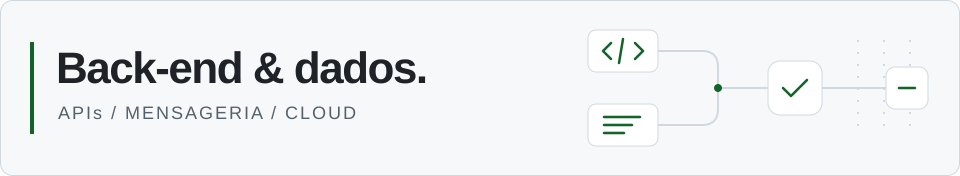

<picture>
  <source media="(prefers-color-scheme: dark)" srcset="assets/header-dark.svg">
  <source media="(prefers-color-scheme: light)" srcset="assets/header-light.svg">
  
</picture>

# Pedro Benitah

Desenvolvo APIs e integrações em **C#/.NET e Python**, com experiência em SQL e projetos acadêmicos de mensageria e AWS. Meu foco de evolução é **engenharia de dados**, conectando essa base de back-end ao trabalho com dados.

Belém, Pará · Ciência da Computação no CESUPA, conclusão prevista para dezembro de 2026.

[Projetos](#projetos-selecionados) · [Experiência](#experiência) · [LinkedIn](https://www.linkedin.com/in/pedro-benitah/) · [E-mail](mailto:pedrobenitah@gmail.com)

## Projetos selecionados

### [01 / Processamento distribuído de imagens](https://github.com/Pedro-Benitah/AWS-CloudFormation)

Recebe imagens por gRPC, distribui o processamento por uma fila e grava o resultado em escala de cinza no S3. Um projeto acadêmico para explorar a separação entre recebimento e processamento.

**Python · gRPC · RabbitMQ · EC2 · S3 · CloudFormation**  
[Arquitetura e configuração](https://github.com/Pedro-Benitah/AWS-CloudFormation#arquitetura)

### [02 / IoT Cloud Dashboard](https://github.com/Pedro-Benitah/iot-cloud-dashboard)

Integra sensores simulados, uma regra de controle e um painel de leituras em tempo real. Explora a comunicação entre serviços usando protocolos diferentes; o controle manual ainda tem limitações de integração.

**Python · Flask · UDP · gRPC · RabbitMQ · SSE**  
[Fluxo e limites do protótipo](https://github.com/Pedro-Benitah/iot-cloud-dashboard)

### [03 / Exploração de dados de churn](https://github.com/Pedro-Benitah/Analise_de_dados)

Dashboard com filtros e visualizações para explorar cancelamento por plano, dispositivo e hábitos de escuta. Um estudo de leitura, agregação e visualização de dados com Pandas.

**Python · Pandas · Streamlit · Plotly · Jupyter**  
[Aplicação](https://github.com/Pedro-Benitah/Analise_de_dados/blob/master/app.py) · [Notebook](https://github.com/Pedro-Benitah/Analise_de_dados/blob/master/Norm.ipynb)

### [04 / Analisador de Portugol](https://github.com/Pedro-Benitah/PortugolDemo)

Analisador léxico e parser preditivo em linha de comando, com exibição de tokens, exportação CSV e acompanhamento de derivações. Um exercício de construção de linguagens e estruturas de dados.

**C# · .NET 8 · Análise léxica · Parser LL(1)**  
[Código e exemplos](https://github.com/Pedro-Benitah/PortugolDemo)

## Experiência

- **Deskcorp — Analista de Testes, atualmente.** Testes funcionais manuais, retestes, regressão, evidências de defeitos e rastreabilidade em Jira/Xray; validação de protótipos no Figma. Também criei e executei um fluxo móvel específico com Maestro.
- **AB Tecnologia — experiência anterior.** Engenharia reversa, análise de dependências, integrações, dados e riscos, documentação técnica e roadmaps de modernização. Estruturei uma metodologia de análise de arquitetura assistida por IA, com prompts customizados e GitHub Copilot. Também atuei com casos de teste, análise de defeitos e incidentes, Jira e Postman.
- **Laboratório Beneficente de Belém — experiência anterior.** Desenvolvimento de sistemas internos em C#/.NET, migração de Visual Basic, testes, documentação, implantação e treinamento de usuários.

## Base técnica e direção

- **Back-end:** C#/.NET, Python, SQL, APIs REST e gRPC, RabbitMQ e integrações.
- **Cloud em projetos acadêmicos:** EC2, S3 e CloudFormation.
- **Dados no portfólio:** leitura de CSV, exploração com Pandas e visualização interativa. Quero avançar para pipelines reproduzíveis, modelagem SQL e qualidade de dados.
- **Qualidade e arquitetura:** rastreabilidade de testes, análise de sistemas e documentação de decisões técnicas.

## Vamos conversar

Tenho interesse em oportunidades de **back-end e engenharia de dados**, além de projetos de **APIs, integrações e automação com Python**. Para conversar sobre vagas ou escopo de um projeto, use o [LinkedIn](https://www.linkedin.com/in/pedro-benitah/) ou [pedrobenitah@gmail.com](mailto:pedrobenitah@gmail.com).

English overview

I build APIs and integrations with C#/.NET and Python, with experience in SQL and academic projects using RabbitMQ, gRPC and AWS. I am developing my portfolio toward data engineering; my current public data project focuses on exploratory analysis with Pandas, Streamlit and Plotly.

I currently work as a Software Test Analyst at Deskcorp. Previous experience includes architecture analysis and modernization at AB Tecnologia, and internal C#/.NET systems at Laboratório Beneficente de Belém. Based in Belém, Brazil; B.Sc. in Computer Science at CESUPA, expected December 2026.

For back-end and data opportunities, API integrations or Python automation projects, contact me on [LinkedIn](https://www.linkedin.com/in/pedro-benitah/) or by [email](mailto:pedrobenitah@gmail.com).

Outros estudos

Publiquei os pacotes educacionais `LerEscreverInfo` e `gerarPalavraa` no [PyPI](https://pypi.org/user/Benitas/) em 2022. Os exercícios mais antigos permanecem nos repositórios como registro de aprendizado.

